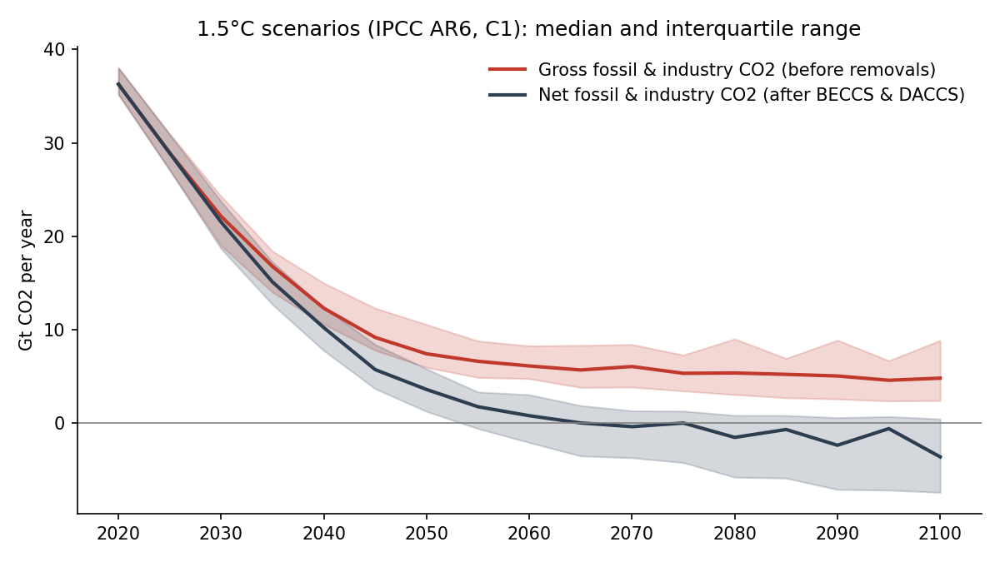
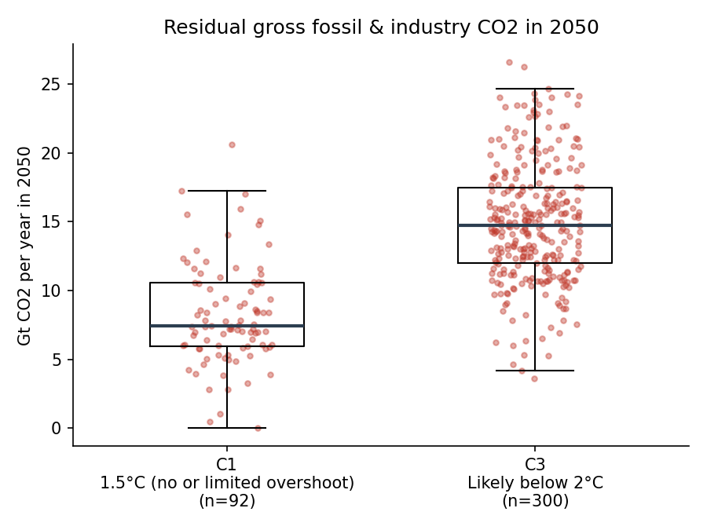

# Residual CO2 emissions in IPCC AR6 mitigation scenarios

How much fossil and industrial CO2 is still emitted in scenarios that limit warming to 1.5°C or 2°C,
and how much carbon dioxide removal balances it?

This notebook reads global scenario data from the **IPCC AR6 Scenarios Database** with
[pyam](https://pyam-iamc.readthedocs.io/), separates **gross** emissions from **net** emissions,
and compares 1.5°C (C1) and 2°C (C3) scenarios.





## Method

- **Scenarios:** AR6 categories C1 (1.5°C, no or limited overshoot) and C3 (likely below 2°C),
  world region
- **Gross fossil & industry CO2** = net `Emissions|CO2|Energy and Industrial Processes`
  + `Carbon Sequestration|CCS|Biomass` (BECCS) + `Carbon Sequestration|Direct Air Capture` (DACCS)
- **Figure 1:** median and interquartile range across C1 scenarios, 2020-2100
- **Figure 2:** distribution of residual gross emissions in 2050, C1 vs C3

## Limits

Gross emissions are approximated from three reported variables. Scenarios that do not report BECCS
or DACCS are treated as having none. Land-use CO2 and land-based removals are not included in the
gross figure. Fewer scenarios report the later years, so the 2080-2100 range is less robust.

## Run it

```bash
pip install -r requirements.txt
```

Open `residual_emissions_ar6.ipynb` in Jupyter or VS Code and run all cells. The first run downloads
about 2 MB of data into `data/` (not included in this repository).

## Data

Byers, E. et al. (2022). *AR6 Scenarios Database hosted by IIASA.* International Institute for Applied
Systems Analysis. https://doi.org/10.5281/zenodo.5886911
